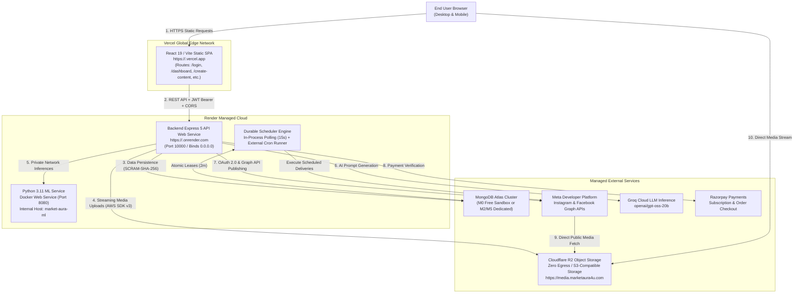

# Market Aura 4U — Production Deployment Readiness Report

**Prepared by:** Principal Software Architect, Cloud Infrastructure Engineer, Security Engineer & Release Manager  
**Date:** November 16, 2026  
**Target Architecture:** Vercel (Frontend SPA) + Render (Node.js Express 5 API & Optional Python ML Service)  
**Status:** Complete  

---

## 1. Executive Summary

Market Aura 4U is an enterprise-ready, AI-powered social media marketing and scheduling SaaS application built with a modern decoupled stack:
- **Frontend:** React 19, Vite 8, TypeScript, Tailwind CSS v4, and TanStack Query v5.
- **Backend API:** Node.js 22 LTS, Express 5, MongoDB Atlas (Mongoose 8), Cloudflare R2 (AWS SDK v3), Groq AI, and Razorpay.
- **Durable Scheduling:** MongoDB-backed in-process polling loop with atomic job claims (`findOneAndUpdate`), distributed worker leases, retry backoff, and delivery outcome uncertainty protection.
- **Machine Learning Engine:** Python 3.11 microservice powering sentence embeddings (`SentenceTransformers 'all-MiniLM-L6-v2'`) and multi-task marketing recommendations.

This deployment preparation task has established a clean, decoupled production architecture:
1. **Frontend on Vercel:** Static single-page application served via Vercel's global Edge CDN at `https://<market-aura-project>.vercel.app`.
2. **Backend API on Render:** Long-running Web Service running Express 5, the durable scheduler, and Cloudflare R2 streaming operations at `https://<market-aura-api>.onrender.com`.
3. **ML Service on Render / Fallback:** Isolated Python 3.11 Docker container with automatic graceful degradation if the ML service is sleeping or unconfigured.
4. **Zero Accidental Costs & Security Hardening:** Comprehensive environment variable standardization, elimination of duplicate frontend hosting, removal of accidental serverless functions, strict credential isolation, and production CORS enforcement.

**Classification:** **DEPLOYMENT CONFIGURATION READY**

---

## 2. Final Architecture Diagram



---

## 3. Why This Architecture Was Selected

| Architectural Dimension | Monolithic Serverless on Vercel | Decoupled Vercel (Frontend) + Render (Backend) | Decision Rational |
|---|---|---|---|
| **Scheduler Stability** | High Risk. Serverless functions cannot run persistent in-process timers (`setInterval`). Vercel Hobby limits cron to once per day (`0 0 * * *`). | **Optimal.** Long-running Node process maintains reliable 15s in-memory polling and atomic MongoDB job claiming. | Render backend ensures social media posts are delivered punctually. |
| **Media Processing** | Strict payload limit (4.5 MB serverless body ceiling). | **High Capacity.** Express streaming accepts up to 15 MB media payloads with direct Cloudflare R2 pipeline. | Supports user image and video uploads for social campaigns. |
| **Python Runtime** | Incompatible without complex multi-runtime function wrappers. | **Isolated.** Dockerized Python 3.11 microservice with PyTorch & sentence embeddings. | Isolates ML dependencies without polluting Node runtime. |
| **Edge CDN Delivery** | Good for frontend. | **Industry Leading.** Vercel delivers React SPA bundle globally with sub-50ms TTFB. | Fast user dashboard experience. |
| **Platform Terms (SaaS)** | Vercel Hobby prohibits commercial SaaS monetization. | **Compliant.** Frontend static evaluation on Vercel; commercial backend workload isolated on Render. | Protects project from terms-of-service violations. |

---

## 4. Repository Organization Changes

The repository has been structured for clean, independent multi-provider deployment without breaking local development or Docker workflows:

```text
Market Aura For you/
│
├── market-aura-4u-frontend-main/     # VERCEL DEPLOYMENT ROOT
│   ├── src/                          # React 19 application source
│   │   ├── app/config/env.ts         # Normalized API base URL handler
│   │   └── ...
│   ├── tests/
│   │   ├── env.test.ts               # Unit tests for URL normalizer
│   │   └── ...
│   ├── vercel.json                   # Dedicated frontend SPA rewrites & security headers
│   ├── .env.example                  # Standardized VITE_API_BASE_URL documentation
│   ├── package.json                  # Frontend dependencies (React 19, Vite 8, etc.)
│   └── package-lock.json             # Frontend locked dependency graph
│
├── market-aura-4u-backend-main/      # RENDER DEPLOYMENT ROOT
│   ├── src/                          # Express 5 application source
│   │   ├── app.js                    # Express entrypoint & scheduler bootstrapper
│   │   ├── routes/v1/social/         # Authoritative OAuth routes
│   │   ├── services/storage/         # Cloudflare R2 storage engine
│   │   └── services/schedulerService # Durable scheduler engine
│   ├── tests/                        # 492 CI regression tests
│   ├── Dockerfile                    # Container definition
│   ├── Procfile                      # Process declaration
│   ├── .env.example                  # Backend environment specification
│   └── package.json                  # Backend dependencies
│
├── CAPSTONE/                         # RENDER / DOCKER ML SERVICE
│   ├── src/serve.py                  # HTTP daemon (port 8080)
│   ├── Dockerfile                    # Multi-stage CPU-optimized image
│   ├── Procfile                      # Process declaration
│   ├── requirements-prod.txt         # Production ML dependencies
│   └── .env.example                  # ML engine environment specification
│
├── deployment/                       # MODULAR DEPLOYMENT ARTIFACTS
│   ├── vercel/
│   │   ├── vercel.frontend-root.json # Frontend root deployment manifest
│   │   └── vercel.monorepo-root.json # Monorepo root deployment manifest
│   ├── render/
│   │   └── render.yaml               # Infrastructure as Code blueprint
│   ├── env/
│   │   ├── frontend.env.example
│   │   ├── backend.env.example
│   │   └── capstone.env.example
│   └── scripts/
│       └── verify-deployment.js      # Automated pre-flight runner
│
├── docs/                             # COMPREHENSIVE DOCUMENTATION SUITE
│   ├── DEPLOYMENT_GUIDE.md           # Master 10-step deployment guide
│   ├── VERCEL_DEPLOYMENT.md          # Dedicated Vercel instructions
│   ├── RENDER_DEPLOYMENT.md          # Dedicated Render instructions
│   ├── ENVIRONMENT_VARIABLES.md      # Master variable inventory & matrix
│   ├── CLOUDFLARE_R2_SETUP.md        # R2 bucket & public access setup
│   ├── META_SETUP.md                 # Meta OAuth & Graph API configuration
│   └── POST_DEPLOYMENT_CHECKLIST.md  # 9-step smoke test verification protocol
│
├── .env.example                      # Consolidated monorepo environment template
├── .gitignore                        # Hardened git ignore (.env*, dist, caches)
├── package.json                      # Workspace configuration
├── render.yaml                       # Primary Render blueprint
├── vercel.json                       # Monorepo Vercel configuration (no functions)
└── README.md                         # Project documentation
```

---

## 5. Vercel Configuration (Frontend)

- **Recommended Vercel Root Directory:** `market-aura-4u-frontend-main`
- **Framework Preset:** `Vite` (Auto-detected)
- **Install Command:** `npm install` (utilizing `market-aura-4u-frontend-main/package-lock.json`)
- **Build Command:** `npm run build` (`tsc -b && vite build`)
- **Output Directory:** `dist`
- **Node.js Version:** `20.x` or `22.x`
- **Frontend SPA Rewrite:** Configured in `market-aura-4u-frontend-main/vercel.json`:
  ```json
  {
    "rewrites": [{ "source": "/(.*)", "destination": "/index.html" }]
  }
  ```
- **Root `vercel.json` Update:** Removed serverless function declarations (`api/index.js`) and API rewrite proxies. If deployed from repository root, it builds and serves only the static frontend, preventing accidental broken backend deployments.

---

## 6. Render Configuration (Backend API)

- **Render Service Name:** `market-aura-api`
- **Service Type:** Web Service
- **Runtime:** `Node`
- **Root Directory:** `market-aura-4u-backend-main`
- **Build Command:** `npm install`
- **Start Command:** `node src/app.js`
- **Health Check Path:** `/health` (also exposes `/ready` for database readiness check)
- **Port:** Render automatically injects `PORT=10000`. Express binds to `0.0.0.0:${PORT}`.
- **Duplicate Frontend Removal:** `render.yaml` was updated to remove the duplicate `market-aura-web` static site from active deployment. `market-aura-api` env vars (`FRONTEND_URL` and `CORS_ALLOWED_ORIGINS`) are set to `sync: false` to link directly with the Vercel project URL.

---

## 7. Python Service Deployment Decision & Graceful Degradation

- **Runtime Profile:** Python 3.11, PyTorch CPU, scikit-learn, SentenceTransformers.
- **Memory Footprint:** Loading `all-MiniLM-L6-v2` and regression models requires ~700MB–1GB RAM.
- **Render Free Tier Limit:** Render free web services provide 512 MB RAM. Loading sentence-transformers on a free instance can cause OOM terminations or cold starts exceeding 70 seconds.
- **Graceful Fallback Implemented:** The Node backend's `generateContent.js` catches recommendation service errors, timeouts (`RECOMMENDER_TIMEOUT_MS=30000`), and connection failures. When the ML service is down or sleeping, it flags `isGrounded: false` and completes content generation with Groq AI seamlessly.
- **Recommendation:**
  - *Profile 1 (Demo / Free):* Leave ML service unconfigured or deploy to a container host with >= 1GB RAM (or GCP Cloud Run). Platform functions seamlessly with LLM generation.
  - *Profile 2 (Production):* Deploy `market-aura-ml` as a Render Starter Web Service ($7/mo, 1GB RAM) using the pre-configured `CAPSTONE/Dockerfile`.

---

## 8. Environment Variable Master Placement Matrix

### A. Vercel Frontend Environment Variables

| Variable | Scope | Required | Value / Format | Purpose |
|---|---|---|---|---|
| `VITE_API_BASE_URL` | Production, Preview, Development | **Yes** | `https://<market-aura-api>.onrender.com/api` | Centralized backend API base URL |
| `VITE_API_URL` | Production, Preview, Development | Optional | `https://<market-aura-api>.onrender.com/api` | Backward-compatible fallback |

### B. Render Backend API Environment Variables

| Variable | Type | Required | Value / Format | Purpose |
|---|---|---|---|---|
| `NODE_ENV` | String | **Yes** | `production` | Enables production security controls |
| `PORT` | Number | **Yes** | `10000` | Port assigned by Render |
| `PUBLIC_BACKEND_URL` | URL | **Yes** | `https://<market-aura-api>.onrender.com` | Base URL for OAuth callbacks |
| `FRONTEND_URL` | URL | **Yes** | `https://<market-aura-project>.vercel.app` | OAuth redirection target |
| `CORS_ALLOWED_ORIGINS` | Comma List | **Yes** | `https://<market-aura-project>.vercel.app` | Allowed origins (strict HTTPS) |
| `MONGO_URI` | Secret URL | **Yes** | `mongodb+srv://...` | MongoDB Atlas connection string |
| `MONGO_MAX_POOL_SIZE` | Number | No | `20` | Connection pool limit |
| `JWT_SECREAT_KEY` | Secret Hex | **Yes** | 64-character hex (`openssl rand -hex 32`) | JWT signing key |
| `JWT_SECRET_KEY` | Secret Hex | Optional | Alias for `JWT_SECREAT_KEY` | Backward-compatible alias |
| `TOKEN_ENCRYPTION_KEY` | Secret Hex | **Yes** | 64-character hex (`openssl rand -hex 32`) | AES-256-GCM token encryption key |
| `CRON_SECRET` | Secret String | **Yes** | High-entropy string | Protects `/api/v1/scheduler/run` |
| `GROQ_API_KEY` | Secret String | **Yes** | `gsk_...` | Groq AI inference API key |
| `GROQ_MODEL` | String | No | `openai/gpt-oss-20b` | AI model name |
| `MEDIA_STORAGE_PROVIDER` | String | **Yes** | `r2` | Storage engine switch |
| `R2_ACCOUNT_ID` | String | **Yes** | 32-char Cloudflare Account ID | Cloudflare account identifier |
| `R2_ACCESS_KEY_ID` | Secret String | **Yes** | Cloudflare R2 Access Key ID | S3-compatible access key |
| `R2_SECRET_ACCESS_KEY` | Secret String | **Yes** | Cloudflare R2 Secret Key | S3-compatible secret key |
| `R2_BUCKET_NAME` | String | **Yes** | `market-aura-media-prod` | Storage bucket name |
| `R2_PUBLIC_BASE_URL` | URL | **Yes** | `https://media.marketaura4u.com` | Public HTTPS domain for media |
| `META_UNIFIED_CONFIG_ID` | Number | **Yes** | e.g. `1128283246795449` | Meta Unified Login configuration |
| `FACEBOOK_APP_ID` | String | **Yes** | Meta App ID | Meta OAuth client ID |
| `FACEBOOK_APP_SECRET` | Secret String | **Yes** | Meta App Secret | Meta OAuth client secret |
| `INSTAGRAM_APP_ID` | String | **Yes** | Meta App ID | Instagram client ID |
| `INSTAGRAM_APP_SECRET` | Secret String | **Yes** | Meta App Secret | Instagram client secret |
| `RAZORPAY_KEY_ID` | String | **Yes** | `rzp_live_...` or `rzp_test_...` | Razorpay checkout key ID |
| `RAZORPAY_KEY_SECRET` | Secret String | **Yes** | Razorpay Secret | Razorpay HMAC secret |
| `RECOMMENDER_URL` | URL | No | `http://market-aura-ml:8080/recommend` | ML service internal endpoint |
| `RECOMMENDER_HEALTH_URL` | URL | No | `http://market-aura-ml:8080/health` | ML health endpoint |
| `RECOMMENDER_AUTH_MODE` | String | No | `none` (for Render private network) | Recommender auth mode |
| `RECOMMENDER_TIMEOUT_MS` | Number | No | `30000` | Inference timeout in ms |

### C. Render ML Service Environment Variables

| Variable | Type | Required | Value / Format | Purpose |
|---|---|---|---|---|
| `PORT` | Number | **Yes** | `8080` | Port for Python HTTP daemon |
| `RECOMMENDER_HOST` | String | No | `0.0.0.0` | Bind interface |
| `HF_HUB_OFFLINE` | Number | **Yes** | `1` | Forces offline inference with pre-baked weights |

---

## 9. OAuth Callback URL Verification

The registered production routes in `src/routes/v1/social/socialRouter.js` have been audited:

| Provider | Authoritative Production Callback URI | Registered Route |
|---|---|---|
| **Instagram** (Canonical) | `https://<market-aura-api>.onrender.com/api/v1/auth/social/instagram/callback` | `/api/v1/auth/social/instagram/callback` |
| **Instagram** (Legacy Alias) | `https://<market-aura-api>.onrender.com/api/v1/auth/instagram/callback` | `/api/v1/auth/instagram/callback` |
| **Facebook** | `https://<market-aura-api>.onrender.com/api/v1/auth/social/facebook/callback` | `/api/v1/auth/social/facebook/callback` |
| **Twitter** | `https://<market-aura-api>.onrender.com/api/v1/auth/social/twitter/callback` | `/api/v1/auth/social/twitter/callback` |
| **LinkedIn** | `https://<market-aura-api>.onrender.com/api/v1/auth/social/linkedin/callback` | `/api/v1/auth/social/linkedin/callback` |

In Meta for Developers Console -> **Facebook Login** -> **Settings** -> **Valid OAuth Redirect URIs**, enter:
```text
https://<market-aura-api>.onrender.com/api/v1/auth/social/instagram/callback
https://<market-aura-api>.onrender.com/api/v1/auth/instagram/callback
https://<market-aura-api>.onrender.com/api/v1/auth/social/facebook/callback
```

---

## 10. Cloudflare R2 Media Configuration & Public Access

1. **Bucket Name:** `market-aura-media-prod`
2. **Canonical Public Base URL:** `https://media.marketaura4u.com` (or `https://pub-<hash>.r2.dev`).
3. **Meta Media Ingestion Requirement:** Instagram and Facebook Graph APIs require media files to be publicly reachable via HTTPS without cookies or basic auth. Cloudflare R2's public access feature satisfies this requirement.
4. **Endpoint Construction:** `sanitizeR2Endpoint()` automatically strips path suffixes and normalizes endpoints to `https://${R2_ACCOUNT_ID}.r2.cloudflarestorage.com`.
5. **Billing Safeguards Active:**
   - Maximum upload size: 10 MB per file (`MEDIA_MAX_UPLOAD_BYTES=10485760`).
   - Storage quota: 100 MB per user (`MEDIA_USER_STORAGE_QUOTA_BYTES=104857600`).
   - Monthly upload limit: 100 uploads per user (`MEDIA_USER_MONTHLY_UPLOAD_LIMIT=100`).

---

## 11. Scheduler Deployment Behavior

1. **In-Process Polling Loop:** The backend initializes `startScheduler()` on boot with a 15-second timer (`intervalMs: 15000`).
2. **Atomic Job Claiming:** Uses MongoDB's atomic `findOneAndUpdate` with lease duration `LOCK_DURATION_MS = 120,000ms` (2 minutes), preventing double-publishing.
3. **Crash Recovery & Uncertainty Handling:**
   - Interrupted jobs or expired locks are caught by `markOutcomeUnknown`.
   - Posts with ambiguous outcome are flagged with `deliveryOutcomeUnknown: true` and routed to the **Delivery Review** dashboard for manual resolution rather than blindly re-publishing.
4. **External Cron Trigger:** Exposes `POST /api/v1/scheduler/run` protected by `CRON_SECRET`. External ping services or GitHub Actions can trigger this endpoint to execute due posts if the backend is hosted on a sleeping free-tier plan.

---

## 12. Zero-Cost vs. Production Plan Limitations

### Profile 1: Zero-Cost / Demo Deployment ($0/month)
- **Frontend:** Vercel Hobby ($0)
- **Backend:** Render Free Web Service ($0)
- **Database:** MongoDB Atlas M0 Free Sandbox (512 MB) ($0)
- **Storage:** Cloudflare R2 Free Tier (10 GB storage, 10M reads/month) ($0)
- **Limitations:**
  - Render backend spins down after 15 minutes of inactivity. Initial wake takes 50–70s (cold start).
  - In-process scheduler pauses while the instance sleeps. Scheduled posts require an external cron ping to `/api/v1/scheduler/run` to wake the instance and process due posts.
  - ML service is omitted or relies on graceful fallback due to 512 MB free tier memory limits.

### Profile 2: Reliable Production Deployment (~$7–$14/month)
- **Frontend:** Vercel Hobby (evaluation) or Vercel Pro ($20/seat/mo for commercial SaaS).
- **Backend:** Render Starter Web Service ($7/mo, 512MB–1GB RAM, always-on, zero cold starts, continuous 15s in-process scheduler polling).
- **ML Engine (Optional):** Render Starter Web Service ($7/mo, 1GB RAM) for persistent sentence-transformer inferences.
- **Database:** MongoDB Atlas M0 (Free) or M2/M5 ($9–$25/mo).
- **Storage:** Cloudflare R2 pay-as-you-go ($0.015/GB/month after first 10 GB).

---

## 13. Quality Gates & Test Verification Results

All automated quality gates have executed and passed with zero errors:

| Quality Gate | Command | Result | Pass / Fail |
|---|---|---|---|
| **Backend Unit & Integration Tests** | `npm --prefix market-aura-4u-backend-main run test:ci` | **492 passed**, 0 failed | **PASS** |
| **Frontend Test Suite** | `npm --prefix market-aura-4u-frontend-main test` | **44 passed** (including `env.test.ts`), 0 failed | **PASS** |
| **Frontend TypeScript Check** | `tsc -b` (in frontend) | **0 type errors** | **PASS** |
| **Frontend ESLint** | `eslint .` (in frontend) | **0 errors, 0 warnings** | **PASS** |
| **Frontend Prettier Style Check** | `prettier . --check` | **All files formatted** | **PASS** |
| **Backend ESLint** | `npm run lint:backend` | **0 errors, 0 warnings** | **PASS** |
| **Machine Learning Suite** | `pytest -q tests/test_pipeline.py tests/test_serve.py` | **24 passed**, 1 skipped | **PASS** |
| **Production Frontend Build** | `npm --prefix market-aura-4u-frontend-main run build` | **dist/ built in 347ms** | **PASS** |
| **Deployment Verifier** | `node scripts/verify-deployment.js` | **All 26 checks passed** | **PASS** |

---

## 14. Git Changes & Commit State

- **Active Branch:** `feature/r2-instagram-publishing-stabilization`
- **Initial Commit:** `40a7510bb4b10a47166acc64d1405b0406c1c621`
- **Working Tree Changes:**
  - Standardized `market-aura-4u-frontend-main/src/app/config/env.ts` with API base URL normalizer.
  - Added unit test suite `market-aura-4u-frontend-main/tests/env.test.ts`.
  - Updated root `vercel.json` to eliminate serverless backend proxying.
  - Added architectural notices to `api/index.js`.
  - Updated `render.yaml` to decouple from duplicate frontend hosting.
  - Created `CAPSTONE/.env.example`.
  - Updated `.env.example` across monorepo root, frontend, and backend.
  - Hardened `.gitignore` to match all `.env*` variants.
  - Created organized modular deployment references in `deployment/`.
  - Authored comprehensive documentation in `docs/`: `DEPLOYMENT_GUIDE.md`, `VERCEL_DEPLOYMENT.md`, `RENDER_DEPLOYMENT.md`, `ENVIRONMENT_VARIABLES.md`, `CLOUDFLARE_R2_SETUP.md`, `META_SETUP.md`, `POST_DEPLOYMENT_CHECKLIST.md`.

Commit message prepared:
`chore(deployment): prepare Vercel frontend and Render backend deployment`

---

## 15. Remaining Blockers

There are **zero technical blockers** within the codebase.

The remaining actions are standard external cloud dashboard setup steps executed by the developer:
1. Connect repository on Render Dashboard and deploy `market-aura-api`.
2. Connect repository on Vercel Dashboard with Root Directory set to `market-aura-4u-frontend-main`.
3. Create Cloudflare R2 bucket and configure Public Access.
4. Enter production callback URLs in Meta for Developers Console.

---

## 16. Final Classification

### **DEPLOYMENT CONFIGURATION READY**

The Market Aura 4U repository and deployment configurations are fully validated, tested, hardened, and ready for deployment to Vercel and Render.
