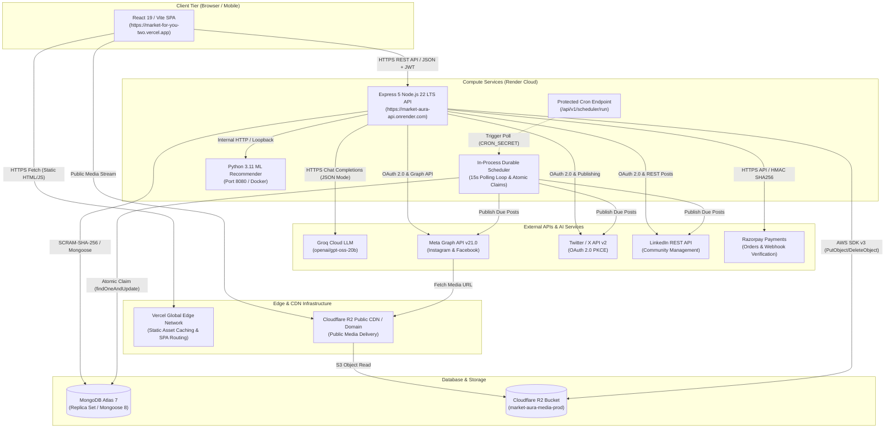
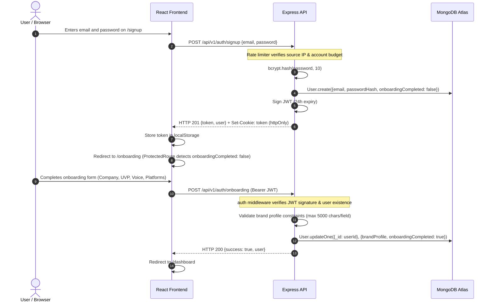
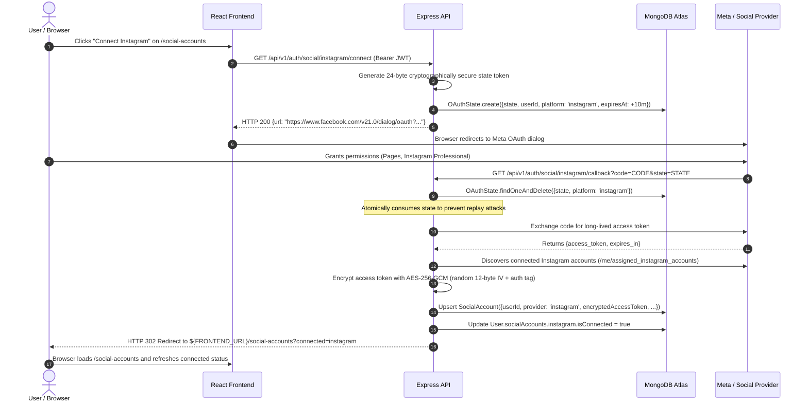
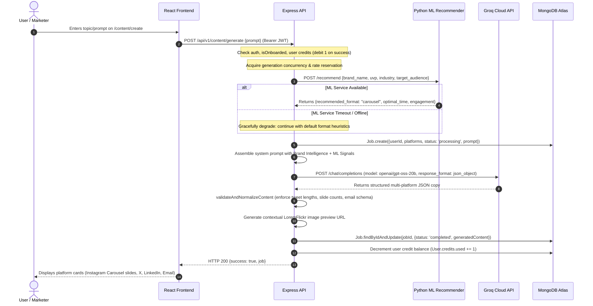
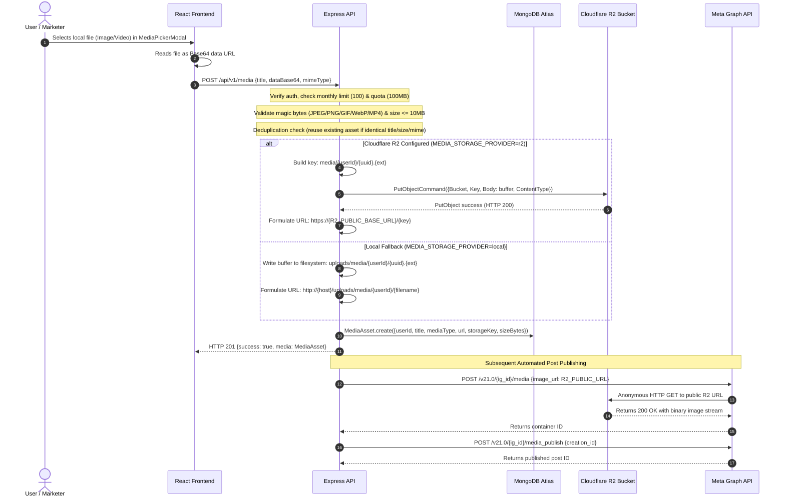
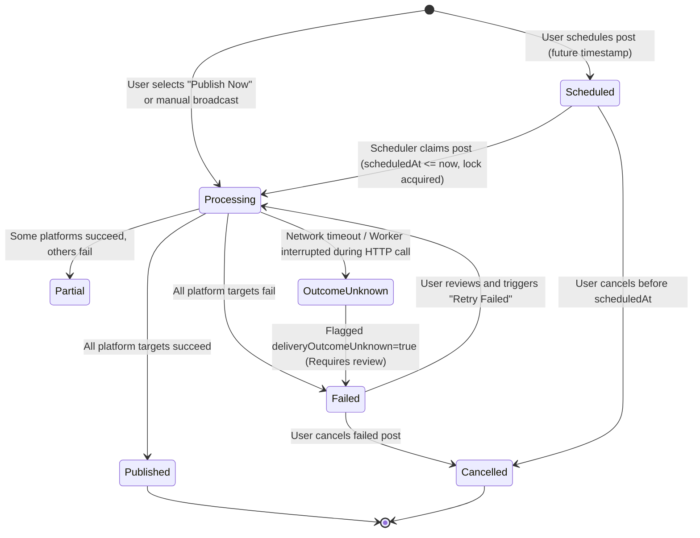

# Market Aura 4U — System Architecture Specification

This document provides software architects and engineers with a comprehensive, technically accurate architectural description of **Market Aura 4U**. It details the component boundaries, runtime topologies, data flows, persistence models, and security boundaries across the entire system.

---

## 1. Architectural Principles & Overview

Market Aura 4U is an enterprise-grade digital marketing automation platform combining:
1. **Brand-Grounded AI Generation:** Combines brand persona intelligence (industry, UVP, target audience, voice, tone) with Groq LLM inference (`openai/gpt-oss-20b`) to produce tailor-made copy for multiple marketing channels in one atomic operation.
2. **ML Recommender Advisory:** A Python 3.11 machine learning microservice (`CAPSTONE`) utilizing sentence transformers (`all-MiniLM-L6-v2`) to recommend optimal content formats (e.g. multi-slide carousels vs single images), predicted engagement rates, topic angles, and optimal posting windows.
3. **Multi-Platform Publishing & Scheduling Engine:** Direct publishing and background-scheduled distribution across Instagram, Facebook Pages, Twitter/X, LinkedIn, Email newsletters (Resend, SendGrid, Webhook), and Blog CMSs (WordPress, Ghost, Hashnode, Webhook).
4. **Resilient Durable Scheduler:** An in-process MongoDB-backed scheduler enforcing atomic distributed leases, preventing duplicate posts upon worker crashes, and isolating provider failures.
5. **Decoupled Cloud Topology:** Frontend Single-Page Application (SPA) on Vercel's global Edge CDN, Node.js Express 5 REST API on Render, MongoDB Atlas for durable document storage, and Cloudflare R2 for zero-egress public media asset hosting.

---

## 2. High-Level System Architecture

The following diagram illustrates the interconnected services, network protocols, external integrations, and cloud hosting infrastructure:

---

## 3. Subsystem Breakdown

### 3.1. Frontend Architecture (`market-aura-4u-frontend-main/`)

- **Framework:** React 19 (`19.2.8`) using TypeScript (`~6.0.2` / 5.x) and Vite (`8.2.2`).
- **Styling:** Tailwind CSS v4 (`4.3.3`) utilizing `@tailwindcss/vite` and design tokens defined in `src/styles/tokens.css`.
- **Routing:** React Router v7 (`7.18.3`) in declarative browser router mode with layout wrappers:
  - `PublicRoute` / `PublicLayout`: Landing page (`/`), error pages.
  - `AuthRoute` / `AuthLayout`: Login (`/login`), Signup (`/signup`).
  - `ProtectedRoute` / `OnboardingRoute`: Guards access to `/onboarding`. Forces un-onboarded users through onboarding before allowing dashboard access; redirects onboarded users directly to the dashboard.
  - `AppLayout`: Side navigation (`Sidebar.tsx`), global header (`Topbar.tsx`), notifications, and active session wrapper for all authenticated views (`/dashboard`, `/content/create`, `/content/history`, `/posts/scheduled`, `/media`, `/billing`, `/social-accounts`, `/settings`).
- **Server State & Data Fetching:** TanStack React Query v5 (`5.102.8`) with automatic caching, background revalidation, and optimistic updates.
- **Form Management & Validation:** React Hook Form (`7.87.0`) paired with Zod (`4.5.4`) schemas (`@hookform/resolvers`).
- **HTTP Client:** Axios (`1.20.0`) configured with:
  - Dynamic base URL normalization (`normalizeApiBaseUrl` in `src/app/config/env.ts`).
  - Request interceptor attaching `Authorization: Bearer <token>` from `localStorage` (`market-aura-auth-token`).
  - Response interceptor automatically clearing credentials on HTTP 401.
  - `withCredentials: true` to support HTTP-only session cookies.

### 3.2. Backend API Architecture (`market-aura-4u-backend-main/`)

- **Runtime:** Node.js 22 LTS (`22.23.5`), Express 5 (`5.1.0`).
- **Database Driver:** Mongoose 8 (`8.19.2`) with connection pool tuning (`maxPoolSize: 20` for long-running services, `10` for serverless, `serverSelectionTimeoutMS: 5000`).
- **Layered Architecture:**
  - `src/app.js`: Express application setup, security middleware, body parsers (100kb default, 15mb for `/api/v1/media`), health check routes (`/health`, `/ready`), graceful shutdown listeners (`SIGINT`, `SIGTERM`), and scheduler bootstrapper.
  - `src/routes/`: Versioned routing mounted at `/api/v1`. Includes `authRouter`, `socialRouter`, `contentRouter`, `postsRouter`, `mediaRouter`, `schedulerRouter`, `paymentRouter`, `settingsRouter`, and `disabledFeaturesRouter`.
  - `src/controllers/`: Business logic handlers for user authentication, onboarding, content generation, post publishing, media library operations, and payment webhooks.
  - `src/models/`: Mongoose schemas with compound indexes, TTL expiration indexes, field projections, and optimistic concurrency controls.
  - `src/middleware/`: Authentication validation (`auth.js`), onboarding gatekeeper (`isOnboarded.js`), IP and account rate limiters (`authAttempts.js`), strict CORS enforcement (`cors.js`).
  - `src/services/`: Modular service layer containing per-platform publishers (`publishers/`), background scheduling service (`schedulerService.js`), and storage abstraction (`storage/`).
  - `src/utils/`: AES-256-GCM token cryptography (`tokenCrypto.js`), SSRF validation, diagnostic collectors, and recommender client wrappers.

### 3.3. Machine Learning Recommender Service (`CAPSTONE/`)

- **Runtime:** Python 3.11 with custom HTTP server (`src/serve.py`) and pipeline orchestrator (`src/pipeline.py`).
- **Models & Libraries:** `sentence-transformers` (`all-MiniLM-L6-v2`), `scikit-learn`, `numpy`, `pandas`.
- **Capabilities:**
  1. Computes dense semantic embeddings of company descriptions and UVPs.
  2. Recommends data-backed content formats (e.g. `carousel`, `image`, `video`).
  3. Predicts engagement scores (expected engagement rate and percentile).
  4. Suggests optimal posting time windows based on historical performance distributions.
  5. Suggests relevant trending topic hooks.
- **Contract Schemas:** Strictly validated via JSON Schema contracts:
  - Input: `CAPSTONE/contract/input_schema.json`
  - Output: `CAPSTONE/contract/output_schema.json`
- **Graceful Fallback Design:**
  - When deployed on platforms with memory constraints (such as Render Free tier 512MiB), the Express backend automatically detects unconfigured or non-responsive recommender endpoints.
  - Content generation degrades gracefully without blocking: the LLM receives fallback advisory signals or generates directly from user brand intelligence, ensuring zero application downtime.
- **Authentication Modes:**
  - `none`: Permitted exclusively for local loopback development (`127.0.0.1`, `localhost`, or internal Docker network hostnames `ml-recommender`, `market-aura-ml`).
  - `cloud-run`: For remote Google Cloud Run deployments, the Node.js backend obtains an OIDC identity token from the GCP metadata server and signs outgoing HTTP requests.

---

## 4. End-to-End Architectural Flows

### 4.1. Authentication & Onboarding Lifecycle

### 4.2. Social Media OAuth Integration Flow

### 4.3. Brand-Grounded AI Generation Flow

### 4.4. Media Upload, Storage & Delivery Subsystem

---

## 5. Durable Background Scheduling Architecture

The post scheduling engine executes automated distribution across connected platforms while preventing race conditions, dual-posting, and worker crashes.

### 5.1. Scheduling Principles
1. **Durable Claims:** Uses MongoDB `findOneAndUpdate` with optimistic locking (`__v`) and distributed worker leases (`lockedBy`, `lockUntil`).
2. **Polling Worker:** An in-process polling loop runs every 15 seconds (`setInterval`) in the Express process.
3. **External Cron Trigger:** Exposes `ALL /api/v1/scheduler/run` requiring `Authorization: Bearer <CRON_SECRET>` or `x-cron-secret: <CRON_SECRET>` to allow external uptime monitors (cron-job.org, GitHub Actions, Cloudflare Workers) to trigger runs even if serverless or sleeping.
4. **Delivery Outcome Uncertainty Protection:** If a worker crashes or network times out while calling an external platform, the outcome is marked as unknown (`deliveryOutcomeUnknown: true`). The post is moved to `failed` and flagged for manual review rather than blindly retried, preventing duplicate customer broadcasts.

### 5.2. Post State Machine

---

## 6. Payment & Subscription Architecture

- **Payment Gateway:** Razorpay API (`razorpay` npm package).
- **Control Gate:** The `disabledFeaturesRouter` middleware checks `CHECKOUT_ENABLED === 'true'`. If disabled, billing routes return HTTP 403 `FEATURE_DISABLED`.
- **Tiers & Credits:**
  - **Starter:** ₹499/month, 500 generation credits.
  - **Pro:** ₹1,499/month, 2,500 generation credits.
  - **Enterprise:** ₹4,999/month, 10,000 generation credits.
- **Verification Security:**
  - Order creation occurs exclusively on the backend (`POST /api/v1/payments/create-order`).
  - Payment signature verification (`POST /api/v1/payments/verify`) computes the expected HMAC SHA256 of `order_id + '|' + payment_id` using `RAZORPAY_KEY_SECRET` and executes a constant-time comparison (`crypto.timingSafeEqual`) to prevent timing attacks.
  - Transaction reuse protection: Checks for prior transactions with the same payment ID to prevent double-crediting.
