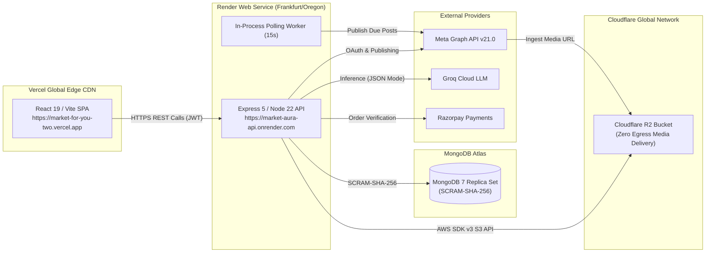

# Market Aura 4U — Master Production Deployment Guide

This guide details the complete, verified deployment architecture and procedure for **Market Aura 4U** across its production cloud infrastructure: **Vercel** (Frontend SPA), **Render** (Node.js Express 5 API), **MongoDB Atlas** (Managed Database), and **Cloudflare R2** (Object Storage).

---

## 1. Verified Production Topography

The canonical production deployment parameters verified against repository configuration are:

- **Frontend Application (Vercel):** `https://market-for-you-two.vercel.app`
- **Backend API Service (Render):** `https://market-aura-api.onrender.com`
- **GitHub Repository:** `https://github.com/Error-Krishna/Market-for-you`
- **Production Instagram Callback:** `https://market-aura-api.onrender.com/api/v1/auth/social/instagram/callback`
- **Production Facebook Callback:** `https://market-aura-api.onrender.com/api/v1/auth/social/facebook/callback`
- **Health Check Endpoint:** `https://market-aura-api.onrender.com/health`
- **Database Readiness Endpoint:** `https://market-aura-api.onrender.com/ready`



---

## 2. Pre-Flight Verification Script

Before deploying changes or promoting a release, execute the automated pre-flight verifier from the repository root:

```bash
npm run verify:deployment
```

This checks:
1. Container manifests (`Dockerfile`, `.dockerignore`, `Procfile`, `nginx.conf`, `vercel.json`, `render.yaml`).
2. Production frontend compilation (`market-aura-4u-frontend-main/dist/index.html`).
3. ML Recommender contract schemas (`input_schema.json`, `output_schema.json`).
4. Template hygiene (ensures no real API keys or tokens are committed in example files).

---

## 3. Database Deployment: MongoDB Atlas

1. **Create an Atlas Cluster:**
   - Log in to [MongoDB Atlas](https://cloud.mongodb.com).
   - Create a free `M0 Sandbox` (or dedicated `M2/M5` for production scale).
   - Region: Select a region close to your Render service (e.g. Frankfurt `eu-central-1` or Oregon `us-west-2`).
2. **Configure Database User:**
   - Security -> Database Access -> Add New Database User.
   - Authentication: Password (`SCRAM-SHA-256`).
   - Permissions: Read and write to database `market_aura`.
3. **Configure Network Access:**
   - Security -> Network Access -> Add IP Address.
   - Add `0.0.0.0/0` (Allow access from anywhere).
   - *Security Note: Render Web Services utilize dynamic outbound IP ranges. Database access is authenticated via TLS and user credentials.*
4. **Obtain Connection String:**
   - Database -> Connect -> Drivers (Node.js).
   - Copy connection string:
     `mongodb+srv://<user>:<password>@cluster0.abcde.mongodb.net/market_aura?retryWrites=true&w=majority`
   - Store as `MONGO_URI`.

---

## 4. Object Storage Deployment: Cloudflare R2

1. **Create Storage Bucket:**
   - Log in to [Cloudflare Dashboard](https://dash.cloudflare.com) -> R2.
   - Create bucket: `market-aura-media-prod`.
2. **Enable Public HTTPS Access:**
   - In bucket Settings -> Public Access:
   - **Option A (Custom Domain):** Connect `media.marketaura4u.com`.
   - **Option B (Managed R2.dev):** Enable `r2.dev` subdomain (e.g. `https://pub-xxxxxxxx.r2.dev`).
   - Store this URL as `R2_PUBLIC_BASE_URL` (must start with `https://` and have no trailing slash).
3. **Generate S3 API Tokens:**
   - R2 -> Manage R2 API Tokens -> Create API Token.
   - Permissions: Object Read & Write.
   - Copy `Access Key ID` (`R2_ACCESS_KEY_ID`), `Secret Access Key` (`R2_SECRET_ACCESS_KEY`), and `Account ID` (`R2_ACCOUNT_ID`).
4. **Configure Bucket CORS:**
   - Under Settings -> CORS Policy, allow your frontend origin:
     ```json
     [
       {
         "AllowedOrigins": [
           "https://market-for-you-two.vercel.app",
           "http://localhost:5173"
         ],
         "AllowedMethods": ["GET", "HEAD"],
         "AllowedHeaders": ["*"],
         "MaxAgeSeconds": 3600
       }
     ]
     ```

---

## 5. Backend API Deployment: Render

The backend is deployed as a long-running Web Service on Render (configured in `render.yaml` or through the Render Dashboard).

### 5.1. Service Settings
- **Service Type:** Web Service
- **Name:** `market-aura-api`
- **Root Directory:** `market-aura-4u-backend-main`
- **Runtime:** `Node`
- **Build Command:** `npm install`
- **Start Command:** `node src/app.js`
- **Plan:** Free (or Starter for 24/7 background scheduler)
- **Health Check Path:** `/health`

### 5.2. Render Environment Variables Reference
Configure the following environment variables in Render Dashboard -> `market-aura-api` -> **Environment**:

```dotenv
NODE_ENV=production
PORT=10000
PUBLIC_BACKEND_URL=https://market-aura-api.onrender.com
FRONTEND_URL=https://market-for-you-two.vercel.app
CORS_ALLOWED_ORIGINS=https://market-for-you-two.vercel.app
MONGO_URI=mongodb+srv://<username>:<password>@cluster0.abcde.mongodb.net/market_aura?retryWrites=true&w=majority
MONGO_MAX_POOL_SIZE=20

# Generate 64-hex strings: openssl rand -hex 32
JWT_SECREAT_KEY=your_64_hex_character_random_secret
TOKEN_ENCRYPTION_KEY=your_64_hex_character_random_key
CRON_SECRET=your_random_cron_secret

# AI Generation
GROQ_API_KEY=gsk_your_groq_api_key_here
GROQ_MODEL=openai/gpt-oss-20b

# Cloudflare R2 Media Storage
MEDIA_STORAGE_PROVIDER=r2
R2_ACCOUNT_ID=your_cloudflare_account_id
R2_ACCESS_KEY_ID=your_r2_access_key_id
R2_SECRET_ACCESS_KEY=your_r2_secret_access_key
R2_BUCKET_NAME=market-aura-media-prod
R2_PUBLIC_BASE_URL=https://pub-xxxxxxxx.r2.dev

# Meta Unified Login & Graph API
META_UNIFIED_CONFIG_ID=1128283246795449
FACEBOOK_APP_ID=your_facebook_app_id
FACEBOOK_APP_SECRET=your_facebook_app_secret
INSTAGRAM_APP_ID=your_instagram_app_id
INSTAGRAM_APP_SECRET=your_instagram_app_secret

# Payments & Billing
CHECKOUT_ENABLED=true
RAZORPAY_KEY_ID=rzp_live_your_key_id
RAZORPAY_KEY_SECRET=your_razorpay_secret
```

---

## 6. Frontend SPA Deployment: Vercel

The frontend is deployed to Vercel as a single-page application using Vite.

### 6.1. Project Configuration
- **Framework Preset:** `Vite`
- **Root Directory:** `market-aura-4u-frontend-main`
- **Build Command:** `npm run build`
- **Output Directory:** `dist`

### 6.2. Environment Variables on Vercel
In Vercel Dashboard -> Project Settings -> Environment Variables:
```dotenv
VITE_API_BASE_URL=https://market-aura-api.onrender.com/api
```

### 6.3. SPA Routing & Security Headers (`vercel.json`)
The frontend repository includes `vercel.json` with:
- Long-term caching for immutable assets in `/assets/` (`Cache-Control: public, max-age=31536000, immutable`).
- Cache busting for `/index.html` (`Cache-Control: no-cache, no-store, must-revalidate`).
- Security headers: `X-Content-Type-Options: nosniff`, `X-Frame-Options: SAMEORIGIN`, `Referrer-Policy: strict-origin-when-cross-origin`.
- Catch-all rewrite to `/index.html` to support client-side React Router navigation without 404s on page refresh.

---

## 7. Critical Production Architectural Considerations

### 7.1. Python ML Recommender Service Separation
- **Render Free Tier Limitation:** PyTorch and `SentenceTransformers ('all-MiniLM-L6-v2')` consume ~800MB–1GB RAM during runtime and inference. Render Free tier limits instances to 512MiB, causing immediate Out-of-Memory (OOM) process restarts.
- **Current Operational State:** The Python ML recommender is **not active on the Free Render deployment**.
- **Graceful Fallback:** The Node.js Express API is engineered with automatic graceful fallback. If `RECOMMENDER_URL` is unset or fails to respond, content generation completes smoothly using fallback heuristics without error.
- **Activation Path:** To enable ML predictions in production, deploy `CAPSTONE/Dockerfile` to a host with >= 1GB RAM (Render Starter plan \$7/mo, Google Cloud Run, or AWS ECS), set `RECOMMENDER_URL`, and restart the backend.

### 7.2. Scheduler Reliability & Free Tier Sleep Limitations
- **In-Process Cron Limitation:** On Render Free tier, web services spin down into sleep mode after 15 minutes of zero incoming HTTP traffic. When the service sleeps, the in-process `setInterval` loop does not fire.
- **Production Solution:**
  1. Configure an external uptime monitor or cron service (e.g. [cron-job.org](https://cron-job.org), GitHub Actions cron, or Cloudflare Worker) to execute an HTTP request every 5–10 minutes:
     ```bash
     curl -X POST https://market-aura-api.onrender.com/api/v1/scheduler/run \
       -H "Authorization: Bearer <CRON_SECRET>"
     ```
  2. Alternatively, upgrade the Render web service to the `Starter` plan ($7/mo) for 24/7 continuous process execution.

### 7.3. Health vs Readiness Checks
- `GET /health`: Returns 200 OK immediately if the Node.js process is alive. **Does not test database availability.**
- `GET /ready`: Tests active MongoDB connection (`mongoose.connection.readyState === 1`). Returns HTTP 200 `{ status: "ready" }` or HTTP 503 `{ status: "not_ready" }`. Use `/ready` for deep diagnostic probes.

---

## 8. Meta Developer Console Configuration

In [Meta for Developers](https://developers.facebook.com) -> Your App -> Facebook Login -> Settings:
Add the exact production callbacks to **Valid OAuth Redirect URIs**:
```text
https://market-aura-api.onrender.com/api/v1/auth/social/instagram/callback
https://market-aura-api.onrender.com/api/v1/auth/instagram/callback
https://market-aura-api.onrender.com/api/v1/auth/social/facebook/callback
```
Ensure **Client OAuth Login** and **Web OAuth Login** are enabled.

---

## 9. Post-Deployment Smoke Tests

Execute these verification checks immediately following deployment:

1. **Readiness Probe:**
   ```bash
   curl -i https://market-aura-api.onrender.com/ready
   # Expected: HTTP 200 {"status":"ready"}
   ```
2. **CORS Preflight Test:**
   ```bash
   curl -i -X OPTIONS https://market-aura-api.onrender.com/api/v1/auth/login \
     -H "Origin: https://market-for-you-two.vercel.app" \
     -H "Access-Control-Request-Method: POST"
   # Expected: HTTP 204 or 200 with Access-Control-Allow-Origin: https://market-for-you-two.vercel.app
   ```
3. **Cron Trigger Test:**
   ```bash
   curl -i -X POST https://market-aura-api.onrender.com/api/v1/scheduler/run \
     -H "Authorization: Bearer <CRON_SECRET>"
   # Expected: HTTP 200 {"success":true,"message":"Processed 0 due post(s)."}
   ```
4. **End-to-End User Journey:**
   - Register a new account at `https://market-for-you-two.vercel.app/signup`.
   - Complete company onboarding.
   - Generate AI copy on `/content/create`.
   - Upload an image to `/media` and confirm it loads from the R2 public base URL.
