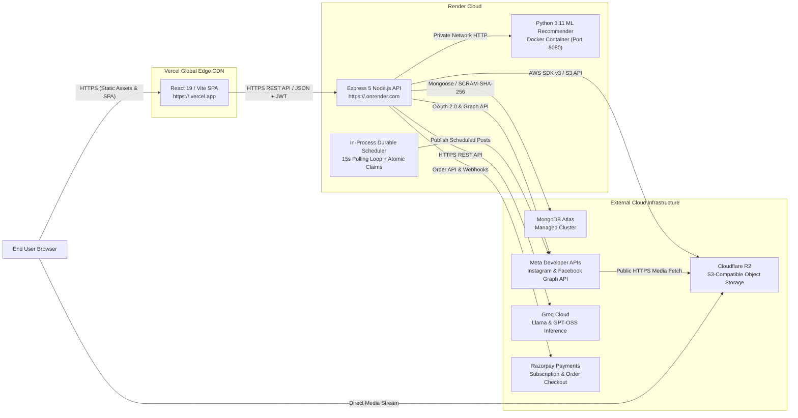

# Market Aura 4U — Master Production Deployment Guide

This guide provides the complete, step-by-step procedure for deploying Market Aura 4U to production using the decoupled **Vercel (Frontend) + Render (Backend API & Optional ML)** cloud architecture.

---

## Architecture Overview



---

## 10-Step Production Deployment Sequence

### Step 1: Repository Preparation

1. **Verify Git Branch & State:**
   Ensure you are on the verified stabilization branch:
   ```bash
   git branch --show-current
   # Expected: feature/r2-instagram-publishing-stabilization
   ```
2. **Review Target Directories:**
   - **Frontend:** `market-aura-4u-frontend-main/` (Deployed to Vercel)
   - **Backend API:** `market-aura-4u-backend-main/` (Deployed to Render)
   - **ML Service:** `CAPSTONE/` (Deployed to Render or container host)
3. **Push Latest Changes to GitHub:**
   When you are ready to trigger deployments, push your branch to GitHub:
   ```bash
   git push origin feature/r2-instagram-publishing-stabilization
   ```

---

### Step 2: MongoDB Atlas Setup

1. Log in to [MongoDB Atlas](https://cloud.mongodb.com).
2. **Create a Cluster:**
   - Deploy a free `M0 Sandbox` (or dedicated `M2/M5` cluster for production workloads).
   - Select a cloud provider and region closest to your Render service (e.g. AWS Frankfurt, Oregon, or Ohio).
3. **Create Database User:**
   - Go to **Security** -> **Database Access** -> **Add New Database User**.
   - **Authentication Method:** Password.
   - **Username:** `market_aura_user`
   - **Password:** Generate a strong 32+ character random password.
   - **Database User Privileges:** Select **Read and write to any database** (or restrict to `market_aura`).
4. **Configure Network Access:**
   - Go to **Security** -> **Network Access** -> **Add IP Address**.
   - Click **Allow Access from Anywhere** (`0.0.0.0/0`).
   - *Security Note: Render Web Services use dynamic IP pools. Database access is securely protected via TLS/SSL encryption and SCRAM-SHA-256 password authentication.*
5. **Obtain Connection String:**
   - Go to **Deployments** -> **Database** -> **Connect** -> **Drivers (Node.js)**.
   - Copy connection string:
     `mongodb+srv://market_aura_user:<password>@cluster0.abcde.mongodb.net/market_aura?retryWrites=true&w=majority`
   - Replace `<password>` with your database password and ensure the database name is `market_aura`. This is your `MONGO_URI`.

---

### Step 3: Cloudflare R2 Media Storage Setup

1. Log in to [Cloudflare Dashboard](https://dash.cloudflare.com) and navigate to **R2**.
2. **Create Bucket:** Create a bucket named `market-aura-media-prod`.
3. **Configure Public Access:**
   - Go to **Settings** -> **Public Access**.
   - Connect a custom domain (e.g. `https://media.marketaura4u.com`) or enable the managed `r2.dev` subdomain (`https://pub-<hash>.r2.dev`).
   - Save this URL as `R2_PUBLIC_BASE_URL` (must start with `https://`).
4. **Generate API Token:**
   - Go to **Manage R2 API Tokens** -> **Create API Token**.
   - Permissions: **Object Read & Write**.
   - Bucket: Specific bucket -> `market-aura-media-prod`.
   - Copy `Access Key ID` (`R2_ACCESS_KEY_ID`), `Secret Access Key` (`R2_SECRET_ACCESS_KEY`), and `Account ID` (`R2_ACCOUNT_ID`).
5. Complete details available in [docs/CLOUDFLARE_R2_SETUP.md](file:///Users/krishnagoyal/Development/Market%20Aura%20For%20you/docs/CLOUDFLARE_R2_SETUP.md).

---

### Step 4: Render Backend API Deployment

1. Log in to [Render Dashboard](https://dashboard.render.com).
2. Click **New +** -> **Web Service**.
3. Connect your Market Aura 4U GitHub repository.
4. **Configure Settings:**
   - **Name:** `market-aura-api`
   - **Root Directory:** `market-aura-4u-backend-main`
   - **Runtime:** `Node`
   - **Build Command:** `npm install`
   - **Start Command:** `node src/app.js`
   - **Plan:** `Free` (or `Starter` for 24/7 reliable scheduling)
   - **Health Check Path:** `/health`
5. **Add Environment Variables:**
   Add all backend environment variables specified in [docs/ENVIRONMENT_VARIABLES.md](file:///Users/krishnagoyal/Development/Market%20Aura%20For%20you/docs/ENVIRONMENT_VARIABLES.md).
   Generate secrets using terminal:
   ```bash
   openssl rand -hex 32 # for JWT_SECREAT_KEY
   openssl rand -hex 32 # for TOKEN_ENCRYPTION_KEY
   openssl rand -hex 24 # for CRON_SECRET
   ```
6. Click **Create Web Service**.
7. Once deployed, note your Render URL: `https://<market-aura-api>.onrender.com`.
8. Verify `/health` and `/ready` endpoints return HTTP 200.

---

### Step 5: Python ML Service Deployment (Optional)

1. The ML recommendation engine is defined in `CAPSTONE/` using Docker.
2. If deploying to Render:
   - Click **New +** -> **Web Service**.
   - Root / Context: `CAPSTONE`
   - Runtime: `Docker` (Dockerfile: `CAPSTONE/Dockerfile`).
   - Plan: `Starter` ($7/mo, recommended for 1GB RAM model consumption).
3. **Graceful Fallback:** If you skip deploying this service, the backend automatically falls back to ungrounded LLM content generation without failing or blocking platform features.

---

### Step 6: Vercel Frontend Deployment

1. Log in to [Vercel](https://vercel.com) and click **Add New...** -> **Project**.
2. Import the Market Aura 4U repository.
3. **Configure Project Settings:**
   - **Framework Preset:** `Vite`
   - **Root Directory:** Click Edit and select `market-aura-4u-frontend-main`.
   - **Build Command:** `npm run build`
   - **Output Directory:** `dist`
4. **Environment Variables:**
   - `VITE_API_BASE_URL`: `https://<market-aura-api>.onrender.com/api`
5. Click **Deploy**.
6. When deployment finishes, copy your public Vercel URL: `https://<market-aura-project>.vercel.app`.

---

### Step 7: Connect Frontend and Backend

Now link the two independent services:
1. In Render Dashboard -> `market-aura-api` -> **Environment**:
   - Set `FRONTEND_URL` to `https://<market-aura-project>.vercel.app`
   - Set `CORS_ALLOWED_ORIGINS` to `https://<market-aura-project>.vercel.app`
   - Set `PUBLIC_BACKEND_URL` to `https://<market-aura-api>.onrender.com`
2. Save changes (Render will trigger an automatic redeploy).
3. Test a preflight OPTIONS request from terminal:
   ```bash
   curl -i -X OPTIONS https://<market-aura-api>.onrender.com/api/v1/auth/login \
     -H "Origin: https://<market-aura-project>.vercel.app" \
     -H "Access-Control-Request-Method: POST"
   ```
   Confirm HTTP 200/204 response with matching `Access-Control-Allow-Origin`.

---

### Step 8: Meta Developer Dashboard Setup

1. In [developers.facebook.com](https://developers.facebook.com) -> Your App -> **Facebook Login** -> **Settings**:
2. Add your production callbacks to **Valid OAuth Redirect URIs**:
   ```text
   https://<market-aura-api>.onrender.com/api/v1/auth/social/instagram/callback
   https://<market-aura-api>.onrender.com/api/v1/auth/instagram/callback
   https://<market-aura-api>.onrender.com/api/v1/auth/social/facebook/callback
   ```
3. Copy **App ID**, **App Secret**, and **Unified Config ID** into your Render environment variables.
4. Detailed setup guide in [docs/META_SETUP.md](file:///Users/krishnagoyal/Development/Market%20Aura%20For%20you/docs/META_SETUP.md).

---

### Step 9: Production Smoke Tests

Execute the complete verification protocol documented in [docs/POST_DEPLOYMENT_CHECKLIST.md](file:///Users/krishnagoyal/Development/Market%20Aura%20For%20you/docs/POST_DEPLOYMENT_CHECKLIST.md):
1. User registration, login, session persistence.
2. Company profile onboarding.
3. AI generation test.
4. Media upload to R2 and public preview.
5. Social account OAuth flow.
6. Post scheduling and manual cron runner verification.

---

### Step 10: Troubleshooting Common Issues

| Symptom | Root Cause | Solution |
|---|---|---|
| **CORS Error (HTTP 403 `ORIGIN_NOT_ALLOWED`)** | `CORS_ALLOWED_ORIGINS` does not match the Vercel domain | Ensure `CORS_ALLOWED_ORIGINS` on Render contains the exact `https://<project>.vercel.app` URL with no trailing slash. |
| **Vercel 404 on page refresh** | SPA rewrite rule missing | Ensure `market-aura-4u-frontend-main/vercel.json` contains `"rewrites": [{"source": "/(.*)", "destination": "/index.html"}]`. |
| **Backend crash: Missing TOKEN_ENCRYPTION_KEY** | Invalid or placeholder key in production | Generate 64-hex key with `openssl rand -hex 32` and configure in Render. |
| **MongoDB Atlas connection timeout** | Atlas IP Access List blocking Render | In Atlas Network Access, add `0.0.0.0/0`. |
| **Meta `redirect_uri_mismatch`** | Callback in Meta console does not match backend | Verify Meta Valid OAuth Redirect URIs match `${PUBLIC_BACKEND_URL}/api/v1/auth/social/instagram/callback` exactly. |
| **Scheduler not posting on Free Tier** | Free Render instance sleeping | Use external cron (e.g. Cron-Job.org) to ping `POST https://<api>.onrender.com/api/v1/scheduler/run` with `CRON_SECRET`, or upgrade to Render Starter ($7/mo). |
