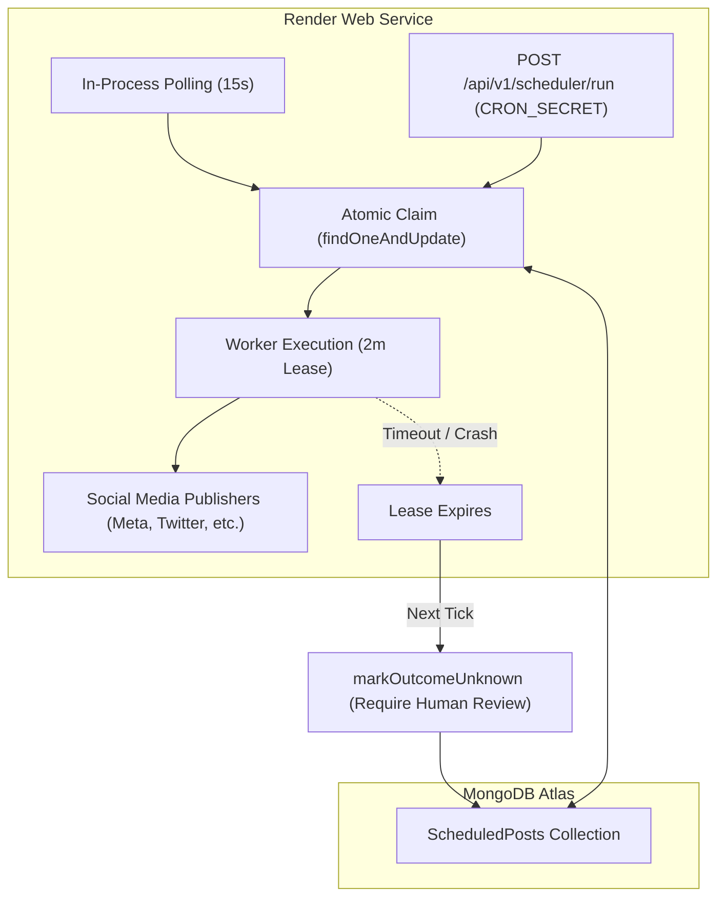

# Market Aura 4U — Render Backend API Deployment Guide

This guide details the deployment of the Market Aura 4U Express 5 / Node.js backend API and optional Python ML recommendation service as independent web services on Render.

---

## 1. Architectural Role & Responsibilities

The Render backend service (`market-aura-api`) is the central brain of Market Aura 4U:
- **Public URL:** `https://<market-aura-api>.onrender.com`
- **Core APIs:** Authentication, user profiles, onboarding, AI prompt orchestration, settings, and Razorpay billing.
- **Media Management:** Direct streaming uploads and multipart handling integrated with Cloudflare R2.
- **Social OAuth:** Handles authorization code exchanges for Meta (Instagram & Facebook), Twitter, and LinkedIn.
- **Durable Scheduling:** In-process MongoDB lease claiming, atomic worker locks, retry handling, and uncertain outcome protection.
- **Health Checks:** `/health` (liveness) and `/ready` (database connectivity probe).

---

## 2. Deployment Profiles & Pricing Considerations

| Dimension | Profile 1: Zero-Cost / Demo | Profile 2: Reliable Production |
|---|---|---|
| **Render Web Plan** | Free ($0) | Starter ($7/month) |
| **Runtime Persistence** | Spins down after 15 min inactivity | 24/7 Always-On persistent process |
| **Scheduler Polling** | Best-effort (sleeps when service sleeps) | Guaranteed continuous 15s in-process polling |
| **External Scheduler Cron** | Required (external ping to `/scheduler/run`) | Optional (in-process runner runs continuously) |
| **Cold Starts** | 50–70 seconds on initial wake | Zero cold starts |
| **ML Engine Hosting** | Optional / Graceful Fallback / Cloud Run | Dedicated Web Service ($7/month, 1GB RAM) |
| **MongoDB Atlas** | M0 Shared Free Sandbox (512MB) | M0 Shared Free or M2/M5 Dedicated |
| **Cloudflare R2** | Free Tier (10GB storage, 10M reads/mo) | Standard Tier (pay-as-you-go) |

> [!WARNING]
> Do not attempt to run a commercial social media scheduling SaaS on a sleeping free-tier instance without understanding the trade-offs. If the instance sleeps, scheduled posts will not trigger until a web request wakes the server or an external cron invokes `/api/v1/scheduler/run`.

---

## 3. Method A: Blueprint Deployment via `render.yaml` (Recommended)

The repository root includes a production Blueprint manifest (`render.yaml`) that configures the backend and optional ML service as Infrastructure as Code.

### Step 1: Connect GitHub Repository on Render
1. Navigate to the [Render Dashboard](https://dashboard.render.com).
2. Click **Blueprints** -> **New Blueprint Instance**.
3. Select and connect your Market Aura 4U GitHub repository.
4. Render detects `render.yaml` in the root directory.

### Step 2: Review Service Declarations
The blueprint defines:
1. `market-aura-api` (Node Web Service, root: `market-aura-4u-backend-main`).
2. `market-aura-ml` (Docker Web Service, context: `CAPSTONE`).

### Step 3: Fill Required Environment Variables
Render prompts for variables flagged with `sync: false`:
- `PUBLIC_BACKEND_URL`: `https://<market-aura-api>.onrender.com`
- `FRONTEND_URL`: `https://<market-aura-project>.vercel.app`
- `CORS_ALLOWED_ORIGINS`: `https://<market-aura-project>.vercel.app`
- `MONGO_URI`: `mongodb+srv://<user>:<password>@<cluster>.mongodb.net/market_aura?retryWrites=true&w=majority`
- `GROQ_API_KEY`: Your Groq API key (`gsk_...`)
- `R2_ACCOUNT_ID`, `R2_ACCESS_KEY_ID`, `R2_SECRET_ACCESS_KEY`, `R2_BUCKET_NAME`, `R2_PUBLIC_BASE_URL`
- `RAZORPAY_KEY_ID`, `RAZORPAY_KEY_SECRET`
- `FACEBOOK_APP_ID`, `FACEBOOK_APP_SECRET`, `INSTAGRAM_APP_ID`, `INSTAGRAM_APP_SECRET`, `META_UNIFIED_CONFIG_ID`

Keys configured with `generateValue: true` (`JWT_SECREAT_KEY`, `TOKEN_ENCRYPTION_KEY`, `CRON_SECRET`) are securely auto-generated by Render.

### Step 4: Apply and Deploy
Click **Apply**. Render builds and provisions both services concurrently.

---

## 4. Method B: Manual Dashboard Service Creation

If you prefer provisioning the web service manually without using the blueprint:

### Step 1: Create Backend Web Service
1. Click **New +** -> **Web Service**.
2. Select your repository.
3. Configure settings:
   - **Name:** `market-aura-api`
   - **Region:** Choose closest region to your MongoDB Atlas cluster (e.g. Frankfurt, Oregon, Singapore).
   - **Branch:** `feature/r2-instagram-publishing-stabilization` (or `main`).
   - **Root Directory:** `market-aura-4u-backend-main`
   - **Runtime:** `Node`
   - **Build Command:** `npm install`
   - **Start Command:** `node src/app.js`
   - **Plan:** `Free` (or `Starter` for production)

### Step 2: Configure Health Check
Under **Advanced**:
- **Health Check Path:** `/health`

### Step 3: Add Environment Variables
Add all environment variables listed in `docs/ENVIRONMENT_VARIABLES.md`.

---

## 5. Python ML Service Deployment Details

The recommendation engine (`CAPSTONE`) is a specialized Python 3.11 service utilizing `SentenceTransformers ('all-MiniLM-L6-v2')`, PyTorch, and scikit-learn models.

### Deployment Options:
1. **Render Docker Service (Included in Blueprint):**
   - Context: `CAPSTONE`
   - Dockerfile: `CAPSTONE/Dockerfile`
   - Exposes port 8080.
   - Internal networking endpoint: `http://market-aura-ml:8080/recommend`.
   - **Memory Requirement:** Sentence-transformer embeddings and model weights require ~700MB–1GB RAM. A Render Starter plan ($7/mo, 1GB RAM) is recommended to prevent OOM termination.
2. **Graceful Fallback Mode (Zero Cost):**
   - If the ML service is not deployed or goes offline, the backend's `generateContent.js` gracefully falls back to ungrounded LLM generation using Groq.
   - Core platform operations (authentication, user onboarding, publishing, scheduling, payments) continue functioning without interruption.

---

## 6. Durable Scheduler Architecture on Render

Market Aura 4U features an enterprise-grade durable scheduler implemented in `src/services/schedulerService.js`:



### Key Scheduler Properties:
1. **Atomic Job Claiming:** Uses MongoDB's atomic `findOneAndUpdate` with lease locks (`LOCK_DURATION_MS = 120,000ms`). Prevents duplicate execution even if multiple instances or external cron triggers overlap.
2. **Delivery Outcome Uncertainty Protection:** If a publishing call times out or network connection drops after dispatching to Meta, the post is flagged with `deliveryOutcomeUnknown: true`. The system requires manual review via the Delivery Review UI rather than blindly retrying, preventing duplicate posts on user feeds.
3. **External Cron Execution:** The endpoint `POST /api/v1/scheduler/run` can be invoked by external cron providers (e.g. Cron-Job.org, EasyCron, GitHub Actions) using the secret token:
   ```bash
   curl -X POST https://<market-aura-api>.onrender.com/api/v1/scheduler/run \
     -H "Authorization: Bearer <CRON_SECRET>"
   ```

---

## 7. Render Troubleshooting & Production Verification

### Issue: CORS 403 `ORIGIN_NOT_ALLOWED`
- **Cause:** `CORS_ALLOWED_ORIGINS` does not match your exact Vercel frontend origin.
- **Fix:** In Render Dashboard -> Environment, ensure `CORS_ALLOWED_ORIGINS` is set to `https://<your-project>.vercel.app` (no trailing slash, strict `https://`).

### Issue: Backend Startup Crashes on `TOKEN_ENCRYPTION_KEY`
- **Cause:** In production (`NODE_ENV=production`), dummy placeholder keys or keys of invalid length are rejected.
- **Fix:** Generate a valid 32-byte hexadecimal key using:
  ```bash
  openssl rand -hex 32
  ```
  Set this as `TOKEN_ENCRYPTION_KEY`.

### Issue: Database Connection Timeout
- **Cause:** MongoDB Atlas Network Access is blocking Render's dynamic IP addresses.
- **Fix:** In MongoDB Atlas -> Network Access, add `0.0.0.0/0` (Allow Access from Anywhere) with strong database user credentials and SCRAM authentication.

### Issue: Cloudflare R2 Upload Fails
- **Cause:** Missing or misconfigured R2 credentials or `R2_PUBLIC_BASE_URL` without `https://`.
- **Fix:** Verify all five required R2 variables in Render: `R2_ACCOUNT_ID`, `R2_ACCESS_KEY_ID`, `R2_SECRET_ACCESS_KEY`, `R2_BUCKET_NAME`, and `R2_PUBLIC_BASE_URL`.
