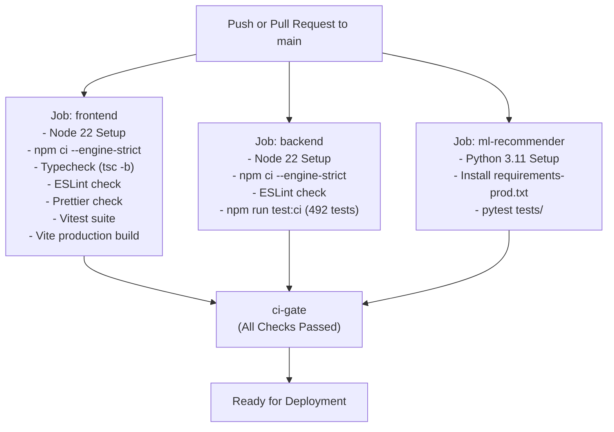

# Market Aura 4U — Testing & Quality Assurance Guide

This document provides a complete guide to running, writing, and debugging automated tests across all tiers of **Market Aura 4U**. It documents unit tests, integration tests, typechecking, linting, pre-commit git hooks, and continuous integration workflows.

---

## 1. Quality Gates & Test Suites Overview

The repository enforces automated quality gates across three decoupled software stacks:

| Tier | Test Framework | Test Command | Scope & Verified Count |
|---|---|---|---|
| **Frontend** | Vitest (`4.1.11`) + Testing Library | `npm run test:frontend` | Component rendering, hooks, error boundaries (8 test files, 44 tests passed) |
| **Backend** | Node.js Built-In Test Runner (`node --test`) | `npm run test:backend` | Controllers, rate limiters, token vault, R2, scheduler, OAuth (31 files, 492 tests passed) |
| **ML Engine** | Pytest (`pytest`) | `npm run test:ml` | Pipeline prediction, embeddings, HTTP endpoints (24 passed, 1 skipped) |
| **Pre-Flight** | Node.js Script (`verify-deployment.js`) | `npm run verify:deployment` | Container manifests, bundle integrity, contract schemas, secret hygiene (All passed) |

---

## 2. Root Workspace Commands

Execute from the root repository directory:

```bash
# Run all code quality checks (Backend ESLint + Frontend TypeScript, ESLint & Prettier)
npm run lint

# Run all automated tests across frontend and backend
npm run test

# Run ML Recommender pytest suite (requires CAPSTONE/.venv)
npm run test:ml

# Execute production frontend build
npm run build

# Run end-to-end pre-flight deployment verification
npm run verify:deployment
```

---

## 3. Frontend Testing & Static Analysis

Working directory: `market-aura-4u-frontend-main/`

### 3.1. Commands
```bash
# Run Vitest test suite
npm test

# Run TypeScript typechecker across all project references
npm run typecheck

# Run ESLint check
npm run lint

# Automatically fix ESLint violations
npm run lint:fix

# Check formatting with Prettier
npm run format:check

# Format all files with Prettier
npm run format

# Run all frontend validation gates (typecheck + lint + format:check)
npm run check

# Verify production bundle build
npm run build
```

### 3.2. Frontend Test Scope
- `tests/contentHistory.test.tsx`: Validates rendering and pagination of generated content history jobs.
- `tests/deliveryReview.test.tsx`: Validates post delivery review, unknown status warning banners, and manual resolution buttons.
- `tests/env.test.ts`: Validates API base URL normalization logic (`normalizeApiBaseUrl`).
- `tests/generatedContentResults.test.tsx`: Validates multi-platform card rendering, slide counts, and image previews.
- `tests/generationErrors.test.tsx`: Validates API error code mapping and user-friendly error messages.
- `tests/mvpExclusions.test.tsx`: Verifies disabled feature boundaries.
- `tests/publishingAndMedia.test.tsx`: Tests media upload validation and publish action dispatching.
- `tests/useContentHistory.test.tsx`: Unit tests for TanStack Query custom content history hooks.

---

## 4. Backend Testing & Static Analysis

Working directory: `market-aura-4u-backend-main/`

### 4.1. Commands
```bash
# Run CI test suite (concurrency=1 for predictable database/mock state)
npm run test:ci

# Run complete test suite including end-to-end integration tests
npm test

# Run isolated MVP journey test
npm run test:isolated-mvp

# Run backend ESLint check (from repository root)
npm run lint:backend
```

### 4.2. Backend Test Scope
The backend test suite uses Node's native `--test` runner with mock timers, Mongoose mock models, and HTTP request simulations:
- **Authentication & Rate Limiting:**
  - `tests/authValidation.test.js`: Payload schema enforcement, 72-byte password boundary, ASCII email rules.
  - `tests/authLimiter.test.js`: Token bucket rate limiting, IP tracking, account stuffing defense.
  - `tests/authProxy.test.js`: Verification of client IP resolution in direct vs trusted-cidrs modes.
  - `tests/authRoutes.test.js`: End-to-end signup, login, and cookie issuance.
- **Content Generation & LLM Safety:**
  - `tests/generateContent.test.js`: Prompt validation, Groq API response normalization, credit debiting.
  - `tests/generationLimiter.test.js`: Per-user concurrency limits and capacity boundaries.
  - `tests/generationSafety.test.js`: Brand profile completeness gate and sanitization.
  - `tests/recommenderGeneration.test.js`: Graceful degradation when recommender is unconfigured or slow.
- **Social Publishing & Scheduling:**
  - `tests/schedulingAndPublishing.test.js`: Distributed lock claiming, atomic worker leases, exponential backoff.
  - `tests/platformOutput.test.js`: Output validation for Twitter (280 chars), LinkedIn, Instagram, Facebook.
  - `tests/socialAccountMultiUser.test.js`: Multi-tenant social account isolation and IDOR protections.
  - `tests/metaUnifiedLogin.test.js`: Meta Unified Login configuration and SUAT account discovery.
- **Storage & Payments:**
  - `tests/r2Storage.test.js`: S3-compatible PutObject/DeleteObject operations and endpoint sanitization.
  - `tests/mediaLibrary.test.js`: Base64 parsing, magic byte detection, user quotas, delete protection.
  - `tests/payment.test.js`: Constant-time Razorpay signature verification and duplicate payment defense.

---

## 5. Machine Learning Recommender Testing

Working directory: `CAPSTONE/`

### 5.1. Commands
```bash
# From repository root
npm run test:ml

# Or directly from CAPSTONE/
cd CAPSTONE
.venv/bin/python -m pytest -q tests/test_pipeline.py tests/test_serve.py tests/test_slim_runtime.py
```

### 5.2. Test Scope
- `tests/test_pipeline.py`: Validates sentence transformer embeddings, format prediction, and engagement estimation.
- `tests/test_serve.py`: Validates HTTP server routes (`GET /health`, `POST /recommend`), JSON input validation, and HTTP error responses.
- `tests/test_slim_runtime.py`: Validates memory consumption and inference execution within container limits.

---

## 6. Pre-Commit & Pre-Push Git Hooks

The repository uses **Husky** (`v9.1.7`) and **lint-staged** (`v17.4.1`) to ensure code quality before commits and pushes:

### 6.1. Pre-Commit Hook (`.husky/pre-commit`)
Fires automatically on `git commit`:
1. Executes `lint-staged`: Runs ESLint with `--fix` and Prettier on staged TypeScript, JavaScript, CSS, and Markdown files.
2. Runs frontend TypeScript compilation check: `npm --prefix market-aura-4u-frontend-main run typecheck`.
3. Runs backend ESLint check: `eslint market-aura-4u-backend-main/src market-aura-4u-backend-main/tests`.

### 6.2. Pre-Push Hook (`.husky/pre-push`)
Fires automatically on `git push`:
1. Runs frontend Vitest suite: `npm --prefix market-aura-4u-frontend-main test`.
2. Runs backend CI test suite: `npm --prefix market-aura-4u-backend-main run test:ci`.

---

## 7. GitHub Actions CI/CD Pipeline

Defined in `.github/workflows/ci.yml`. Triggers on all pushes and pull requests targeting the `main` branch.

### Pipeline Structure:


---

## 8. Manual Smoke Testing Procedures

In addition to automated tests, execute these manual smoke tests when validating live staging or production releases:

1. **User Journey:** Sign up with a new email address -> Complete 6-field company onboarding -> Verify redirect to `/dashboard`.
2. **AI Content Generation:** Go to `/content/create` -> Enter a brief -> Verify structured copy renders for all enabled channels.
3. **Media Upload & Preview:** Go to `/media` -> Upload a PNG and an MP4 file -> Confirm file renders from the public R2 domain.
4. **Social OAuth Connection:** Connect a test Twitter/X or Meta account on `/social-accounts` -> Verify callback completes and account displays as "Connected".
5. **Scheduled Post Delivery:** Schedule a post 2 minutes in the future -> Verify post status transitions from `scheduled` to `processing` and then `published`.
