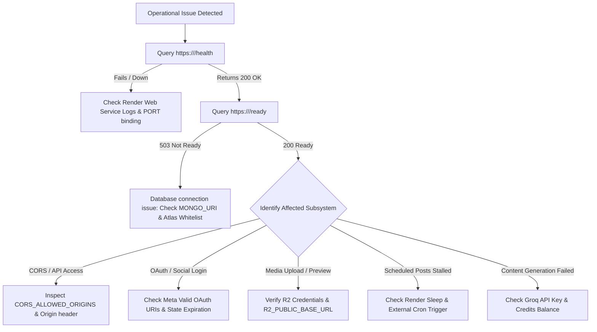

# Market Aura 4U — Troubleshooting & Operations Runbook

This runbook provides verified diagnostic procedures and solutions for common operational issues encountered across local development, staging, and production environments of **Market Aura 4U**.

---

## 1. Quick Diagnostic Flowchart



---

## 2. Common Issues & Verified Solutions

### 2.1. Database & Connectivity

#### Symptom: Server crashes or `/ready` returns HTTP 503 (`database: "unavailable"`)
- **Root Cause 1:** MongoDB Atlas Network Access is blocking the backend connection. Render Web Services utilize dynamic outbound IP pools.
  - **Solution:** In MongoDB Atlas -> **Security** -> **Network Access**, ensure `0.0.0.0/0` (Allow access from anywhere) is active.
- **Root Cause 2:** Special characters in MongoDB password are unencoded.
  - **Solution:** Percent-encode special characters in your database password (e.g. `@` -> `%40`, `:` -> `%3A`).
- **Root Cause 3:** Connection pool exhaustion on Atlas M0 Sandbox.
  - **Solution:** Set `MONGO_MAX_POOL_SIZE=20` (or `10`) in backend environment variables to prevent exhausting Atlas connection quotas.

---

### 2.2. Cross-Origin Resource Sharing (CORS)

#### Symptom: Browser console shows `CORS Error` and network tab shows HTTP 403 `ORIGIN_NOT_ALLOWED`
- **Root Cause:** The `Origin` header sent by the frontend does not match an entry in `CORS_ALLOWED_ORIGINS` on Render.
- **Enforcement Rules in Code (`src/config/cors.js`):**
  - In `production`, origins MUST use the `https:` protocol.
  - Wildcards (`*`) are strictly forbidden.
  - Trailing slashes are strictly forbidden (e.g. `https://market-for-you-two.vercel.app/` will fail; use `https://market-for-you-two.vercel.app`).
  - No subpaths or query strings.
- **Solution:**
  1. Open Render Dashboard -> `market-aura-api` -> **Environment**.
  2. Set `CORS_ALLOWED_ORIGINS` to the exact Vercel domain:
     ```text
     https://market-for-you-two.vercel.app
     ```
  3. If using custom domains, provide comma-separated values:
     ```text
     https://market-for-you-two.vercel.app,https://app.marketaura4u.com
     ```

---

### 2.3. Social Media OAuth & Callback Failures

#### Symptom: Meta returns `OAuthException: redirect_uri_mismatch`
- **Root Cause:** The redirect URI sent in the authorization request does not match the entries registered in the Meta Developer Console.
- **Solution:**
  1. Go to [developers.facebook.com](https://developers.facebook.com) -> Your App -> **Facebook Login** -> **Settings**.
  2. In **Valid OAuth Redirect URIs**, ensure the exact canonical and alias paths are present:
     ```text
     https://market-aura-api.onrender.com/api/v1/auth/social/instagram/callback
     https://market-aura-api.onrender.com/api/v1/auth/instagram/callback
     https://market-aura-api.onrender.com/api/v1/auth/social/facebook/callback
     ```
  3. Ensure `PUBLIC_BACKEND_URL` on Render is set to `https://market-aura-api.onrender.com` without a trailing slash.

#### Symptom: Frontend redirects to `/social-accounts?error=invalid_or_expired_state`
- **Root Cause 1:** The user took longer than 10 minutes to complete the OAuth dialog. The state token expired in MongoDB via TTL index.
  - **Solution:** Re-initiate the connection from `/social-accounts`.
- **Root Cause 2:** User attempted to reuse a callback link or clicked the browser back button.
  - **Solution:** State tokens are single-use (`OAuthState.findOneAndDelete()`). Return to `/social-accounts` and start a new connection.

#### Symptom: Backend returns HTTP 500 `CONFIGURATION_ERROR: META_UNIFIED_CONFIG_ID environment variable is required in production`
- **Root Cause:** In `production`, Meta Unified Login requires a valid numeric configuration ID.
- **Solution:** Configure `META_UNIFIED_CONFIG_ID` (e.g. `1128283246795449`) in Render environment variables.

---

### 2.4. Cloudflare R2 Media Storage & Public Previews

#### Symptom: Media upload fails with `UnknownError NotFound`
- **Root Cause:** The `R2_ENDPOINT` variable had the bucket name suffixed (e.g. `https://<id>.r2.cloudflarestorage.com/bucket-name`). AWS SDK v3 appends the bucket name automatically, causing a 404 on the storage cluster.
- **Solution:** Leave `R2_ENDPOINT` empty (it is auto-derived by `sanitizeR2Endpoint()`) or specify only the base endpoint: `https://<R2_ACCOUNT_ID>.r2.cloudflarestorage.com`.

#### Symptom: Instagram publishing fails with `Media could not be downloaded by Meta`
- **Root Cause:** The media URL stored in MongoDB is a local path or unauthenticated URL that Meta's crawlers cannot reach.
- **Solution:**
  1. Ensure `MEDIA_STORAGE_PROVIDER=r2` is configured in production.
  2. Verify `R2_PUBLIC_BASE_URL` is configured with a valid public HTTPS domain (`https://media.marketaura4u.com` or `https://pub-xxx.r2.dev`).
  3. Verify the R2 bucket public access setting is enabled in the Cloudflare Dashboard.

#### Symptom: Media upload returns HTTP 413 `STORAGE_QUOTA_EXCEEDED` or HTTP 429 `MONTHLY_UPLOAD_LIMIT_EXCEEDED`
- **Root Cause:** The account has reached the free safeguard limits (100 MiB aggregate storage or 100 uploads per calendar month).
- **Solution:** Delete unused media assets from `/media` or adjust `MEDIA_USER_STORAGE_QUOTA_BYTES` and `MEDIA_USER_MONTHLY_UPLOAD_LIMIT` in environment variables.

---

### 2.5. AI Generation Failures

#### Symptom: Generation returns HTTP 402 `INSUFFICIENT_CREDITS`
- **Root Cause:** The user account has used all allocated monthly generation credits (`credits.used >= credits.monthly`).
- **Solution:** Upgrade subscription tier on `/billing`, or manually increment user credits in MongoDB:
  ```javascript
  db.users.updateOne({ email: "user@example.com" }, { $inc: { "credits.monthly": 500 } });
  ```

#### Symptom: Generation returns HTTP 504 `Content generation timed out`
- **Root Cause:** Groq API or intermediate connection exceeded the bounded deadline (`GROQ_TIMEOUT_MS`, default 45 seconds).
- **Solution:** Re-submit the request. Ensure `GROQ_TIMEOUT_MS` is set to at least `45000`.

---

### 2.6. Scheduled Posts & Background Scheduler

#### Symptom: Posts scheduled in the future are never published on Render Free Tier
- **Root Cause:** Render Free web services spin down into sleep mode after 15 minutes of zero incoming HTTP traffic. The internal `setInterval` timer is frozen while the service is asleep.
- **Solution:**
  1. Configure an external cron monitor (e.g. [cron-job.org](https://cron-job.org) or GitHub Actions cron) to invoke the protected scheduler runner every 5–10 minutes:
     ```bash
     curl -X POST https://market-aura-api.onrender.com/api/v1/scheduler/run \
       -H "Authorization: Bearer <CRON_SECRET>"
     ```
  2. Alternatively, upgrade the Render instance to the **Starter Plan** ($7/mo) for 24/7 continuous execution.

#### Symptom: Post shows status `failed` with banner `Delivery outcome unknown`
- **Root Cause:** A network timeout or worker interruption occurred while calling the social platform API. To prevent double-posting, Market Aura 4U halts automatic retries and flags the post for manual review.
- **Solution:**
  1. Navigate to `/posts/scheduled` and find the post.
  2. Check the live social profile (Instagram, X, etc.) to see if the post appeared.
  3. In the **Delivery Review** panel, click **Resolve as Published** (if it went through) or **Retry Failed** (if it did not publish).

---

### 2.7. Payments & Billing

#### Symptom: Billing page returns HTTP 403 `FEATURE_DISABLED`
- **Root Cause:** The `CHECKOUT_ENABLED` environment variable is not set to `'true'`.
- **Solution:** Add `CHECKOUT_ENABLED=true` in Render environment variables.

#### Symptom: Payment verification fails with signature mismatch
- **Root Cause:** `RAZORPAY_KEY_SECRET` in the backend environment does not match the Razorpay account whose `key_id` was loaded by the frontend checkout.
- **Solution:** Ensure both `RAZORPAY_KEY_ID` and `RAZORPAY_KEY_SECRET` originate from the same Razorpay Dashboard environment (Test vs Live).

---

### 2.8. Frontend Routing & SPA 404s

#### Symptom: Refreshing any page other than `/` on Vercel returns HTTP 404
- **Root Cause:** Missing SPA catch-all rewrite in Vercel configuration.
- **Solution:** Verify `market-aura-4u-frontend-main/vercel.json` exists with the rewrite rule:
  ```json
  {
    "rewrites": [
      {
        "source": "/(.*)",
        "destination": "/index.html"
      }
    ]
  }
  ```
